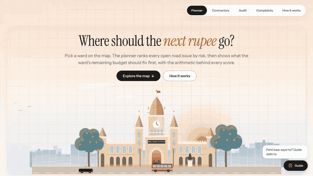
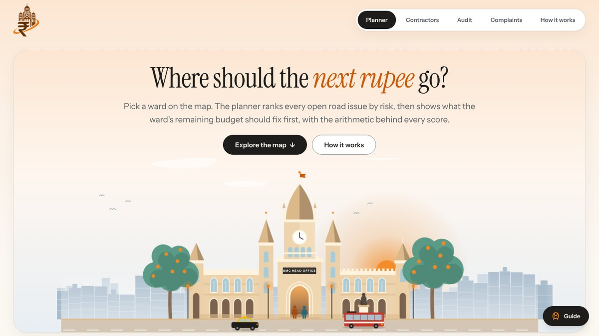
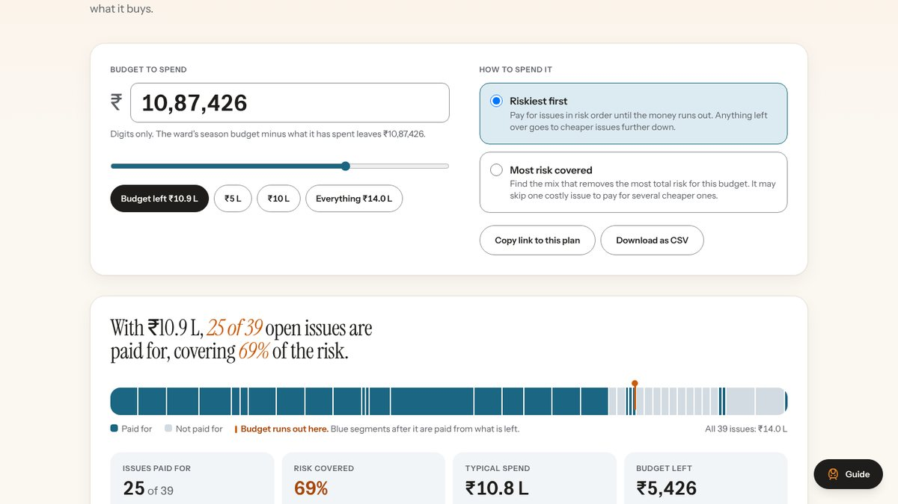
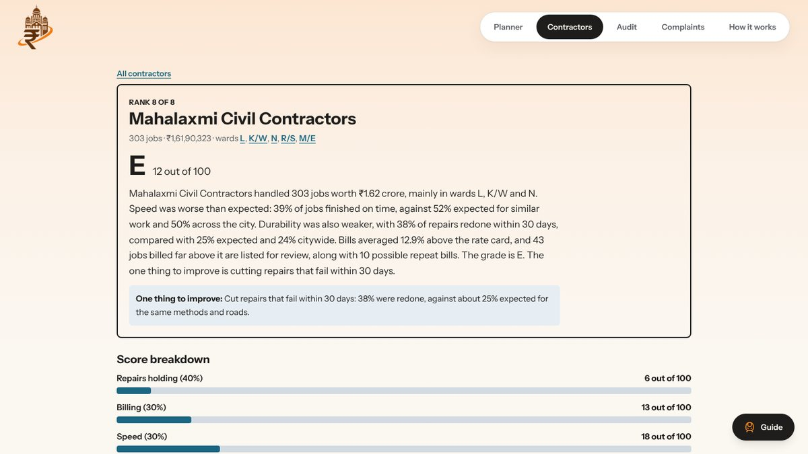
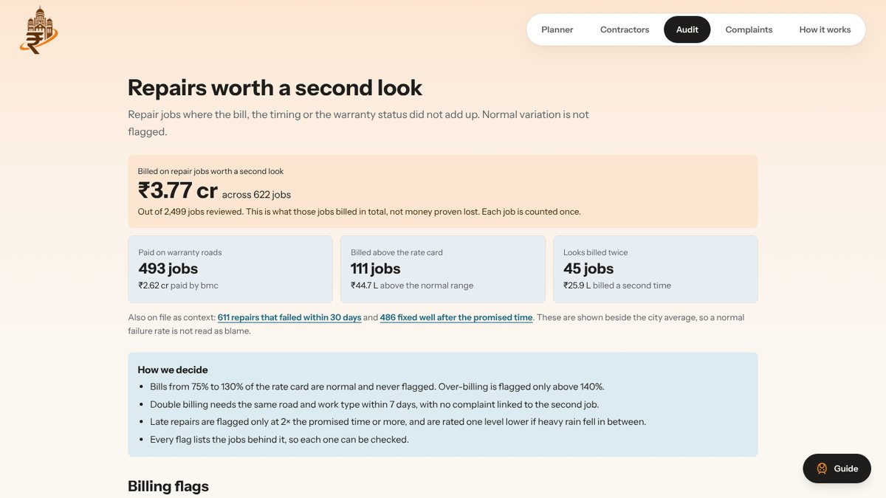
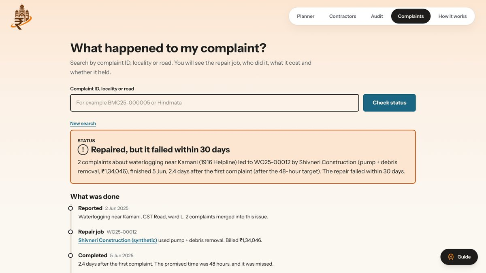

<div align="center">


# Follow the Rupee
### Where should a Mumbai ward's next road-repair rupee go, and why should you trust the answer?


**Built at Claude Impact Lab Mumbai, 21 November 2026**

[](docs/demo.mp4)

<sub>Click the preview to play the full demo with captions: [`docs/demo.mp4`](docs/demo.mp4)</sub>

</div>

---

## The problem

Every monsoon Mumbai spends crores fixing the same roads. Citizens complain, repairs are logged, and the potholes come back. Nobody can easily answer three questions: **where did the money go, did the fix last, and who is responsible?**

## What we built

One valuable feature, with the evidence behind it. The **Next Rupee Planner** is the hero: pick a ward, type the budget it has left, and see exactly which open road issues to fix first, ranked by risk, with the arithmetic shown. Everything else on the site exists to answer "why trust this ranking?".

| Step in the brief | Where to find it | What you see |
|---|---|---|
| **Budget smarter** (the hero) | `/` and `/plan/F-N` | A map of all 24 wards, then a per-ward planner. Change the budget and watch the budget line show where the money runs out. Open any issue to see how its score was added up. |
| **Hold to account** | `/contractors` | A grade for each of 8 contractors, judged against what is expected for the same work, wards and weather, so a hard patch is not marked down. |
| **Audit** | `/audit` | Repair jobs where the bill, the timing or the warranty status did not add up. Normal variation is not flagged. Every flag lists the jobs behind it. |
| **Connect the trail** | `/complaints` | Search a complaint ID or locality and follow it: the repair job, who did it, what it cost, and whether it held. |
| **Trust** | `/method` | How the ranking works, how it was tested, and what it cannot tell you. |

The pages link to each other: a planner recommendation links to the contractor's scorecard, a warranty note links to the audit, a complaint ID links to its trail, and each of those links back to the ward's plan.

<table>
<tr>
<td width="50%"><br><sub><b>Pick a ward.</b> All 24 wards on one map, flat or 3D.</sub></td>
<td width="50%"><br><sub><b>Spend the budget.</b> The line shows where the money runs out.</sub></td>
</tr>
<tr>
<td width="50%"><br><sub><b>Hold to account.</b> Graded against what is expected for the same work.</sub></td>
<td width="50%"><br><sub><b>Audit.</b> Flags with a reason, a next step and the jobs behind them.</sub></td>
</tr>
<tr>
<td colspan="2" align="center"><br><sub><b>Connect the trail.</b> From complaint to repair to whether it held.</sub></td>
</tr>
</table>

## How the ranking works

- **A transparent weighted score, not a black box.** Each open issue gets 0 to 100 points: severity 30, flooding 25, repair history 15, traffic 10, accidents 10, nearby schools and hospitals 10. Every factor is scaled against all roads in the city, so you can check any number.
- **Precision aids on every issue:** exact re-scoring in the browser, a cost range, a rank range under small changes in the weights, and a confidence level (high, medium, or check on site) based on how the road was matched.
- **Budget logic:** "riskiest first" pays in rank order until the money runs out; "most risk covered" finds the mix that removes the most total risk for the budget. Roads under warranty cost BMC nothing, and the original contractor repairs them.
- **Tested:** the ranking is back-tested on the next two months of data, and the budget solver is checked against brute force. See `/method` and `web/public/data/validation.json`.

## What the data says (synthetic)

| | |
|---|---|
| Work orders reviewed | 2,499 |
| Complaints merged into issues | 6,501 into 3,529 |
| Open issues ranked | 589 across 24 wards |
| Repair jobs worth a second look | 622 jobs, ₹3.77 crore billed |
| Of those | 493 paid on warranty roads, 111 billed above the rate card, 45 look billed twice |
| Repairs that failed within 30 days | 24.6% of repaired issues |

The ₹3.77 crore is what the flagged jobs billed in total. **It is not money proven lost**, and the site says so. Flags are a reason to look, not a verdict.

## Claude's part

Claude writes the plain-language ward summaries and contractor scorecards from the numbers the pipeline computes. Its text is checked for length, for using only the supplied numbers, and for tone, with a template fallback when a check fails. The ranking and the flags themselves come from ordinary code you can read.

## Built for real people

Written for a ward officer, a corporator or a citizen: plain language, no accusations, status shown by word and symbol and not by colour alone, 44px touch targets, keyboard navigation, a skip link, and a short guided tour of the site (the Guide button).

## Run it

```bash
# 1. Data (optional: the JSON the site reads is already committed)
cd pipeline && cp .env.example .env     # add ANTHROPIC_API_KEY only to regenerate the Claude text
uv run pytest -q && uv run pipeline all

# 2. Site
cd ../web && npm install && npm run dev  # http://localhost:3000
npm test && npm run lint && npm run build
```

Deploying to Vercel: set **Root Directory** to `web`, leave the defaults, no environment variables needed.

```
data/        input CSVs (synthetic, read-only)
pipeline/    Python: complaints → issues → work orders, audit, scorecards, budget, Claude narration
web/         Next.js 16 app, reads web/public/data/*.json
shared/      schema.md, the JSON contract between the two
docs/        the brief, data dictionary, and the demo video
```

## Team

**Prathik Shetty** built the data pipeline, the ranking and the planner. **Noel Gomes** built the audit, contractor and complaint-trail pages, the cross-links between them, the guided tour and the visual polish.

## About the data

Everything here is synthetic. Ward, road and locality names are real; every amount, date, record and contractor is invented. Do not use it to judge any real person, contractor or department. Data and brief by Claude Impact Lab Mumbai, released under [CC BY 4.0](https://creativecommons.org/licenses/by/4.0/); see [`docs/CHALLENGE.md`](docs/CHALLENGE.md).
